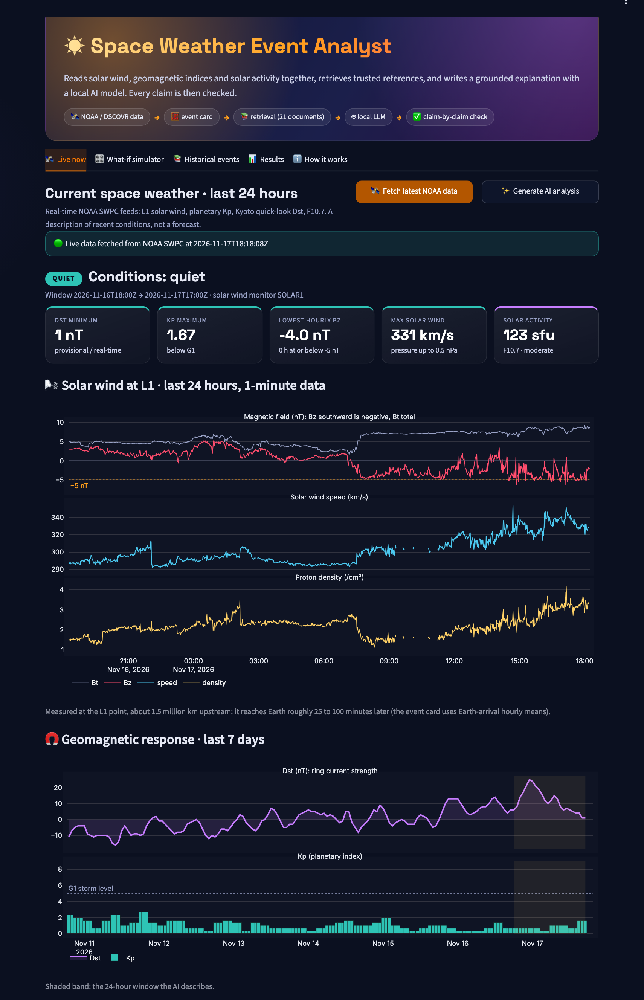
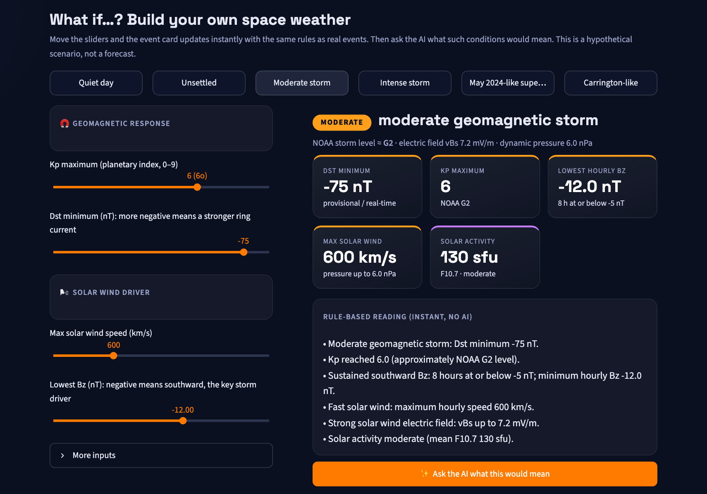
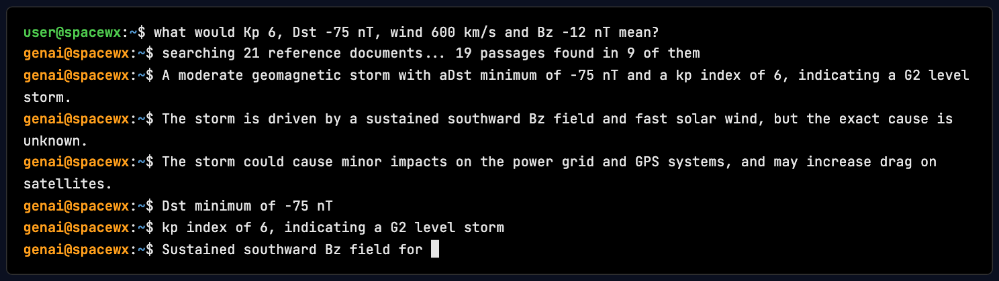
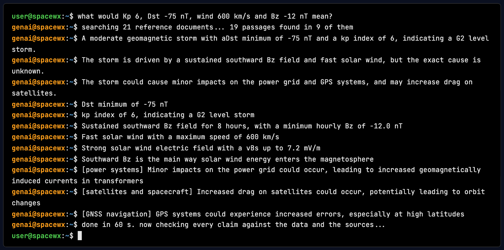
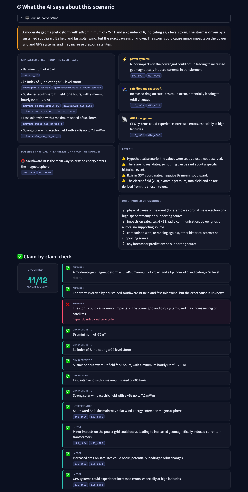
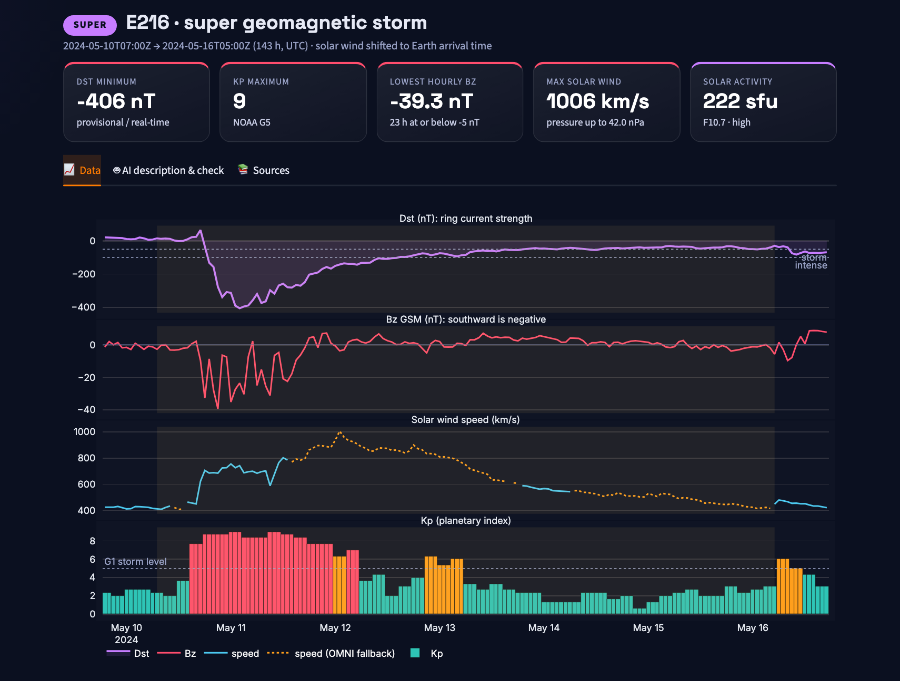
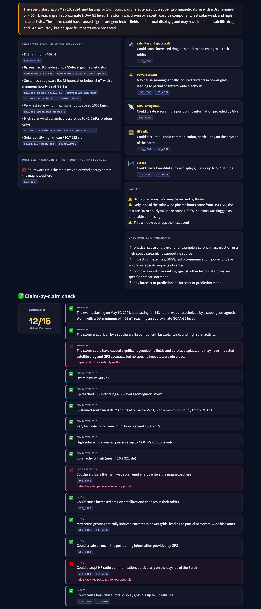
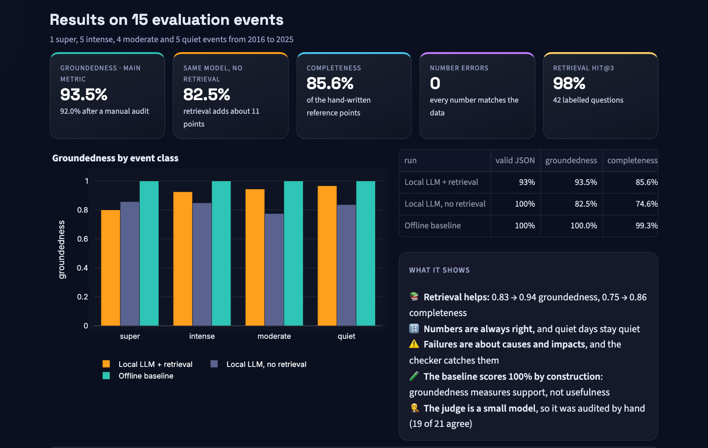
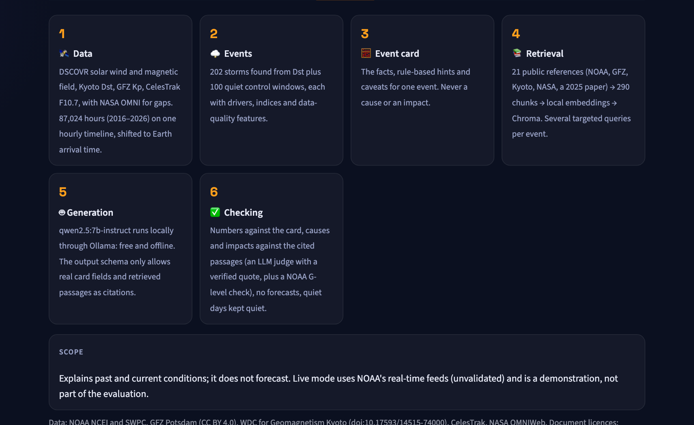

# Spaceweather_GENAI_RAG

**GenAI-Based Multi-Parameter Space Weather Event Analysis and Impact Assessment**
upGrad Masters in ML/AI, GenAI track, Bring Your Own Capstone. Mid-work snapshot 25 Oct 2026, updated 17 Nov 2026.

> **Where I am right now (17 Nov).** The full pipeline works end to end: data, events, event cards, knowledge base, retrieval, prompt templates, two generators (an offline baseline and a free local LLM), a claim-by-claim checker and the evaluation. The code is in `src/spacewx_rag/` with a command-line entry point, a config file the code reads, and 58 tests. There is a Streamlit demo app (`streamlit run app/main.py`) with a live mode that pulls the last day of real-time NOAA data and analyses it. Still to do: the technical report and the presentation. Section 7 has the table and section 8 the results.

## 🎬 The demo app

### ▶️ How to run it

**First time only** (after the installation steps in section 5):
```bash
brew install ollama                 # or the installer from ollama.com
brew services start ollama
ollama pull qwen2.5:7b-instruct     # the local LLM, 4.7 GB, free
cp .env.example .env                # LLM_PROVIDER=ollama, LLM_MODEL=qwen2.5:7b-instruct
```

**Every time:**
```bash
cd Spaceweather_GENAI_RAG
source .venv/bin/activate
brew services start ollama          # start the local LLM
streamlit run app/main.py           # or: make app
```
Then open **http://localhost:8501**. The sidebar shows **🟢 ready** when the model is available. The app loads the model in the background on start, so the first answer is quick.

**When you are done:**
```bash
# Ctrl+C in the terminal running Streamlit, then
brew services stop ollama           # frees about 5 GB of memory
```

**Before a demo:**
- Turn **Low Power Mode off** (System Settings → Battery). It makes the model about 3× faster: roughly 1 minute per answer instead of 3 to 5.
- Close Chrome tabs and other heavy apps. The model needs about 5 GB of free memory.
- Keep the laptop plugged in and on a hard surface. Long runs make it warm.
- Press **🛰️ Fetch latest NOAA data** once to check the network. Without internet the app falls back to the last saved snapshot.

**Without Ollama** the app still works. Historical events, results, the live data, and the simulator's instant reading all run without it; only the buttons that ask the AI are disabled.

**If something goes wrong:**

| Problem | Fix |
|---|---|
| Sidebar shows ⚪ offline and the AI buttons are greyed out | `brew services start ollama`, then reload the page |
| An error after the code was changed | Auto-reload is off (`.streamlit/config.toml`), so stop the app (Ctrl+C) and run `streamlit run app/main.py` again |
| Answers are very slow | Low Power Mode is on, or memory is full; close apps and check `ollama ps` shows `100% GPU` |
| 🟠 "showing the last saved snapshot" on the live tab | NOAA or the network is unavailable; press Fetch again later |
| Port 8501 already in use | `streamlit run app/main.py --server.port 8502` |

The app has five tabs. Historical events and results read the saved outputs, so they work without the model; the buttons that ask the AI need Ollama running.

### 🛰️ Live now: today's space weather
One click on **Fetch latest NOAA data** pulls the last day of NOAA SWPC's real-time feeds (L1 solar wind, planetary Kp, Kyoto quick-look Dst, F10.7) and builds an event card with the same rules as the historical events. The solar wind is plotted at 1-minute resolution and Kp and Dst for the past week. **Generate AI analysis** then explains the last 24 hours. It describes recent conditions, it does not forecast, and it falls back to the last saved snapshot if NOAA or the network is down.



### 🎛️ What-if simulator: build your own storm
Pick a preset (quiet day up to Carrington-like) or move the sliders for Kp, Dst, solar wind speed and Bz. The storm class, NOAA G level, derived electric field and the rule-based reading update instantly, with no AI. Physically unusual combinations are flagged. The scenario card has no dates, so the model cannot present it as a real event.



### 💬 Asking the AI: a terminal chat
Pressing **Ask the AI** opens a terminal where the question is asked and the local model (`qwen2.5:7b-instruct`) answers line by line as it writes: first the retrieval step, then each sentence of the summary, each characteristic, the physical interpretation and the potential impacts tagged by area. The model really produces structured JSON in the background (the schema only allows real card fields and retrieved chunk ids as citations); the terminal shows the readable sentences as they arrive.

While it is writing:



Finished:



### ✅ The answer and the claim-by-claim check
When the model finishes, the answer appears as a summary, characteristics with the card fields they came from, the physical interpretation and impact cards with their source chunks, caveats and what could not be supported. Below it every claim is checked: numbers against the card, causes and impacts against the cited passages (an LLM judge that must quote its support, plus a code check on the NOAA G level), no forecasts, nothing stormy for quiet windows. In this run the checker caught an impact claim slipped into the summary (❌, 11 of 12 grounded).



### 📚 Historical events: the 15 evaluation events
Choose an event in the sidebar (for example E216, the May 2024 super storm) to see its metric cards and the storm plot (Dst, Bz, solar wind speed with the OMNI-filled hours dotted, colour-coded Kp). The sub-tabs show the saved AI description with its claim check (from the main run, the no-retrieval ablation or the offline baseline), the retrieved sources with their licences, and a **Generate live now** button to rerun the model on that event.



<details><summary>The saved AI description and claim check for E216</summary>



</details>

### 📊 Results
The headline numbers from notebook 07: groundedness with and without retrieval, completeness, number errors and retrieval hit@3, groundedness by event class for the three runs, and a short reading of what they show.



### ℹ️ How it works
The six pipeline stages on one page, and the scope (explains past and current conditions; no forecasting).



Screenshots are made with `python scripts/capture_screenshots.py` (Playwright) against the running app.

## 1. What this project is
Space weather data comes from a few different places: solar wind and the magnetic field measured by the DSCOVR satellite, the Kp and Dst indices that describe how disturbed Earth's magnetic field is, and the F10.7 number for solar activity. To understand what happened during a storm you have to read all of them together, and that takes some expertise.

My idea is to build a system that does this in four steps:

1. Put all the sources on one hourly timeline and automatically find storms and quiet periods.
2. Turn each event into a small structured "event card" (the facts, a few rule-based hints, and warnings about data quality).
3. Look up trustworthy background text in a knowledge base (this is the retrieval part of RAG).
4. Have a language model write a short, structured description of the event that only uses the card and the retrieved text, then check every claim in it.

It is not a forecasting model. It only looks at past events and has no live data feed.

## 2. Business objective
- **The problem:** going from raw numbers to a clear assessment of an event takes expert knowledge and a lot of manual work. Dashboards show one parameter at a time. Simple thresholds can tell you that activity is high but not why. A plain LLM will write something that sounds right but may not be supported by the data.
- **Who it's for:** space weather analysts and engineers first, then satellite operators and other space engineering teams.
- **Main success measure:** groundedness, meaning how many of the claims in a generated summary can be backed up by the input data or the retrieved sources. I also measure retrieval relevance, completeness, unsupported claims and consistency.

## 3. Dataset source and licence
Everything about where the data comes from, its formats, what I found while checking it and the caveats is in [`data/DATA_SOURCES.md`](data/DATA_SOURCES.md).

| Data | Provider | Licence / terms |
|---|---|---|
| Solar wind and magnetic field, 1-minute (DSCOVR) | NOAA NCEI | US Government data; NWS policy says public domain unless noted |
| Kp, ap, F10.7 | GFZ Potsdam | CC BY 4.0 |
| Kp, ap, F10.7 (daily table) | CelesTrak | free to use, cite CelesTrak |
| Dst, hourly | WDC for Geomagnetism, Kyoto | free for scientific use without restrictions, no commercial use; acknowledge WDC Kyoto and cite the data DOI (doi:10.17593/14515-74000) |
| Hourly cross-check data | NASA OMNIWeb | public; cite King and Papitashvili 2005 |

The knowledge base has 21 documents. Their licence status is listed one by one in `knowledge_base/raw_docs/MANIFEST.csv`. They are 14 NOAA documents, GFZ, Kyoto WDC, a NASA tutorial, the Hayakawa et al. 2025 paper (CC BY 4.0) and a Wikipedia page (CC BY-SA 4.0). Kyoto's terms allow scientific use with credit but don't say whether its web pages can be redistributed, so I included its three documents for academic, non-commercial use with attribution. I haven't verified the licence of the NASA tutorial. The code itself is a course submission, all rights reserved (see `LICENSE`).

**Getting the raw data:** it's about 390 MB so I haven't included it. Run `python scripts/download_data.py`. Use `--dry-run` to just list the files, or `--years 2024` to grab one year as a quick test. The processed files you need for the cards, retrieval, generation and evaluation are included.


## 4. Repository structure
| Path | What's in it |
|---|---|
| `src/spacewx_rag/` | the pipeline as a package: `data` (loading, cleaning, alignment), `events` (storms, quiet windows, features), `cards`, `knowledge` (extraction, chunking, embeddings, index), `retrieval`, `generation` (prompts, schema, generators), `evaluation` (claim checks, judge, metrics), `utils` (paths, config), `cli.py` |
| `configs/parameters.yaml` | every parameter; the code reads it |
| `prompts/` | `system.md` (generation rules), `event_user.md` (card + passages), `judge_support.md` (support judge; `_v1` kept for comparison) |
| `notebooks/` | `01`-`05` exploration and the mid-work stages (outputs saved), `06_rag_generation`, `07_evaluation` (call `src/`, outputs saved) |
| `data/processed/` | `aligned_hourly.parquet`: 87,024 hourly rows x 20 columns, 2016-07-26 to 2026-06-29 (UTC) |
| `data/events/` | `event_table.parquet` / `.csv` (302 events) and `event_cards.jsonl` (302 cards) |
| `knowledge_base/` | 21 source documents + `MANIFEST.csv`, cleaned text, `chunks.jsonl` (290 chunks). The Chroma index in `vector_store/` is rebuilt by `python -m spacewx_rag kb` |
| `evaluation/reference_events/` | the 15 evaluation events, their cards and `reference_points.json` (what each description should and shouldn't say) |
| `evaluation/annotations/` | `retrieval_questions.json` (42 labelled questions), `judge_audit_ollama_rag.csv` (manual check of the judge) |
| `evaluation/results/` | `generations/<run>/E###.json` (every output with its prompt passages), `generation_metrics.csv`, `generation_summary.csv`, `claims.csv`, `consistency.csv`, `retrieval_*.csv`, `judge_cache.jsonl` |
| `tests/` | `unit/` (hint rules, classes, chunking, retrieval filter, schema, claim checks, judge quote and G-level checks) and `integration/` (src/ rebuilds the notebook outputs exactly) |
| `docs/` | `architecture.md`, `methodology.md`, `decision_log.md` (58 decisions), `event_definitions.md`, `project_plan.md` |
| `scripts/download_data.py`, `scripts/capture_screenshots.py`, `Makefile` | raw data download; README screenshots of the running app; shortcuts for every stage |
| `docs/screenshots/` | the app screenshots used in this README |
| `app/main.py` | Streamlit demo: 🛰️ live NOAA conditions, 🎛️ what-if simulator (sliders → AI explanation), 📚 historical events (data, streamed AI description, claim-by-claim check, sources), 📊 results |
| `src/spacewx_rag/live/` | fetches NOAA SWPC real-time feeds, saves snapshots, builds a live event card (`data/live/`) |

## 5. Installation
You need Python 3.10 or newer (I used 3.11).
```bash
python3.11 -m venv .venv
source .venv/bin/activate
pip install -r requirements-dev.txt
pip install -e .                      # installs the spacewx_rag package and the `spacewx` command
python -m ipykernel install --user --name spaceweather-genai-rag --display-name "Python (Spaceweather_GENAI_RAG)"
cp .env.example .env                  # set LLM_PROVIDER=ollama and LLM_MODEL=qwen2.5:7b-instruct
```
The first retrieval call downloads the embedding model (BAAI/bge-small-en-v1.5, about 130 MB).

**The LLM is free and runs locally** through [Ollama](https://ollama.com). No API key is needed. About 5 GB of disk and 8 GB of free memory:
```bash
brew install ollama && brew services start ollama     # or the installer from ollama.com
ollama pull qwen2.5:7b-instruct                       # 4.7 GB, the generator and the judge
```
Without Ollama everything except LLM generation and the judge still runs; `--provider baseline` gives the offline generator.

## 6. Execution steps
Everything runs from the project folder with `python -m spacewx_rag <stage>` (or `make <target>`):

| Stage | Command | Time |
|---|---|---|
| raw files -> interim caches | `python -m spacewx_rag interim` (needs `scripts/download_data.py` first) | minutes |
| aligned hourly table | `python -m spacewx_rag align` | ~10 s |
| events | `python -m spacewx_rag events` | seconds |
| event cards | `python -m spacewx_rag cards` | seconds |
| knowledge base + index | `python -m spacewx_rag kb` | ~1 min |
| offline baseline | `python -m spacewx_rag generate --provider baseline` | seconds |
| local LLM, 15 events | `python -m spacewx_rag generate --provider ollama --run ollama_rag` | 15-30 min on an M2 |
| ablation, consistency | see `make generate` | ~40 min |
| evaluation | `python -m spacewx_rag evaluate` | ~10 min the first time (judge), then seconds (cached) |
| tests | `pytest` | ~20 s |
| **demo app** | `streamlit run app/main.py` (or `make app`), then open http://localhost:8501 | instant |

The included files mean you can start at any stage. The generated outputs and judge verdicts are included too, so `python -m spacewx_rag evaluate` and notebooks 06 and 07 run in minutes without regenerating. To re-run the notebooks: `make notebooks`.

## 7. Current implementation status
| What the brief asks for | Status |
|---|---|
| Business problem and objectives | **Done** (this README and the proposal) |
| Data collection, preparation, preprocessing | **Done.** Six sources; hourly aligned table with a speed-dependent time shift, source labels and quality flags |
| Event detection and feature extraction | **Done.** 202 storms and 100 quiet windows with features |
| Context preparation | **Done.** 302 event cards with hints, caveats and the claims that need a retrieved source |
| Knowledge base and retrieval | **Done.** 21 documents, 290 chunks, local embeddings, Chroma, event-aware multi-query retrieval (one query per impact area) |
| Prompt / interaction design | **Done.** Templates in `prompts/`, a pydantic output schema, and a per-event constrained schema so citations can only be real card fields and retrieved chunks |
| Generation with an LLM | **Done.** Offline extractive baseline + `qwen2.5:7b-instruct` through Ollama (free, local); no-retrieval ablation; consistency runs |
| Safeguards against unsupported claims | **Done.** Constrained decoding, then a claim-by-claim checker (numbers and dates vs the card, cause and impact language, evidence paths, citations, an LLM judge that must quote its support, a code-based NOAA G-level check) |
| Evaluation | **Done.** Groundedness, unsupported-claim rate, completeness against hand-written reference points, must-not checks, consistency, retrieval relevance on 42 questions, and a manual audit of the judge |
| Modular code and tests | **Done.** `src/spacewx_rag/`, config-driven, CLI, 58 tests; `src/` reproduces every notebook output exactly |
| Streamlit app | **Done.** `app/main.py`: historical events read the saved outputs (no model needed); "Generate" streams the local LLM, shows rule checks at once and the judge after (~1 min) |
| What-if simulator (extra) | **Done.** Sliders for Kp, Dst, speed and Bz build a hypothetical card; instant rule-based reading, then the AI explains it with the same checks (decision 58) |
| Live data (extra) | **Done.** One click fetches the last day of NOAA SWPC real-time data, builds an event card and analyses it; falls back to the last snapshot when offline (decision 57) |
| Technical report, presentation | Not yet (final phase) |

## 8. Results so far (15 evaluation events)
| Run | Valid JSON | Groundedness | Card claims grounded | Cause/impact claims grounded | Completeness | Must-not violations |
|---|---|---|---|---|---|---|
| **Local LLM + retrieval** (`ollama_rag`) | 14/15 | **0.935** (0.920 after manual audit) | 0.96 | 0.86 | 0.86 | 0 |
| Local LLM, no retrieval (ablation) | 15/15 | 0.825 | 1.00 | 0.00 | 0.75 | 0 |
| Offline extractive baseline | 15/15 | 1.000 | 1.00 | 1.00 | 0.99 | 0 |

- **Retrieval helps:** with the same model, groundedness goes from 0.83 to 0.94 and completeness from 0.75 to 0.86. Without passages the model still writes physics claims, with no source.
- **The model gets the numbers right** (no number errors) and keeps quiet windows quiet (no impacts, no storm language). Its failures are about causes and impacts: G5 effects claimed for a G4 storm, a flare mechanism given for a storm, a misread angle, impact language in the summary. It often leaves out Kp and the G level (7 of 14).
- **The baseline scores perfectly by construction** (it copies card hints and passage sentences), which shows that groundedness measures support, not usefulness.
- **The judge is lenient.** Against a manual check of 21 claims, the final judge (v2 with a required quote, plus a code-based G-level check) agrees on 19 with no false rejects. I quote the audited groundedness.
- **Consistency** (5 events x 3 runs): summaries are similar (cosine 0.86 to 0.95) but the number of impacts varies between runs.
- **Retrieval relevance:** hit@1 0.79, hit@3 0.98, MRR 0.87 on 42 questions; hit@3 0.96 on the 24 questions labelled before retrieval was run.

Details: notebooks 06 and 07, `evaluation/results/`, and decisions 44 to 56 in `docs/decision_log.md`.

## 9. Known limitations
- 15 evaluation events with one super storm; one generator model (7B, 4-bit), and the judge is the same model. Groundedness from the judge is an upper bound.
- The reference points and the manual judge audit were drafted by the coding assistant from the cards and documents; I still need to review them before the final numbers are quoted.
- The consistency run covers 5 events, not 15, to save laptop time.
- One output of 15 was invalid (a repetition loop); a list-length cap now prevents it, but the recorded run is reported as it was.
- The DSCOVR instruments have long outages and the Faraday cup misreads fast wind, so about 35% of plasma hours come from OMNI; every hour records its source. Dst from 2021 on is provisional (10 of 15 evaluation events).
- Retrieved background is general (by storm class) except for May 2024. G-level-specific effects depend on retrieving the right row of the NOAA scales, which often fails (the source of the E231 errors).
- Kyoto's terms don't say whether its web pages can be redistributed (included for academic, non-commercial use with credit); the NASA tutorial's licence is unverified.
- Local generation is slow: 1 to 1.5 minutes per event on an M2 laptop with Low Power Mode off (3 to 5 minutes with it on). The app streams the text so the wait is visible.
- Live mode uses unvalidated real-time data from whichever L1 monitor NOAA has active (SOLAR1 on 17 Nov, not DSCOVR) and covers only the last 24 hours; it is a demonstration, not part of the evaluation.

## 10. Next steps
1. Review the reference points and the judge audit; consider retrieving the NOAA scales row for the event's own G level so impacts match the storm level.
2. Technical report (10 to 15 pages), presentation (8 to 12 slides), final README.

## More documentation
[`docs/architecture.md`](docs/architecture.md) · [`docs/methodology.md`](docs/methodology.md) · [`docs/decision_log.md`](docs/decision_log.md) (58 decisions with the evidence behind them) · [`docs/event_definitions.md`](docs/event_definitions.md) · [`data/DATA_SOURCES.md`](data/DATA_SOURCES.md) · [`knowledge_base/README.md`](knowledge_base/README.md)
