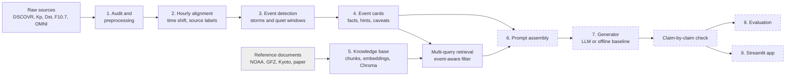

# Architecture

This document explains how the system is put together and what I still plan to build. Stages 1 to 5 are done (as notebooks with saved results). Stages 6 to 9 are only designed so far. The reasons behind each choice are in `decision_log.md`.

## 1. The big picture


Solid boxes are built. Dashed boxes are still planned.

The same thing in plain text:
```
Raw data -> audit -> hourly aligned table -> events -> event cards ----+
                                                                       +-> prompt -> generator -> checker -> evaluation / app
Reference documents -> chunks -> embeddings -> Chroma -> retrieval ----+
```

## 2. The parts

### 2.1 Data preparation (built, notebooks 01 and 02)
- I use six sources: the DSCOVR magnetometer and Faraday cup (1-minute data), Kyoto Dst (hourly), GFZ Kp and ap (every 3 hours), CelesTrak F10.7 (daily), and NASA OMNI (hourly), which I use to cross-check and to fill gaps.
- What I found while checking the data decided the cleaning rules. Missing values become NaN. If a day has several versions of a file, I keep the latest. I only use some of the quality flags. Hours where at least 75% of the Faraday cup minutes are flagged use OMNI plasma values instead, because the Faraday cup gives wrong speeds in fast wind. Gaps in the magnetometer are filled from OMNI. Every hour records where its value came from.
- Everything is put on an hourly UTC timeline. DSCOVR sits about 1.5 million km upstream of Earth, so I shift its data forward by 1.5e6 km divided by the solar wind speed. With that shift the Bz correlation with OMNI is 0.919, compared with 0.718 without it.
- The result is `data/processed/aligned_hourly.parquet` (87,024 rows, 20 columns).

### 2.2 Event detection (built, notebook 03)
- **Storms:** I look for runs of hourly Dst at or below -50 nT. Runs less than 12 hours apart are merged into one event. Each event window starts 12 hours before the run and ends when Dst climbs back above -30 nT. Storms are classed by their lowest Dst as moderate, intense or super. This gives 202 storms.
- **Quiet windows:** 48-hour blocks where Dst stays above -30 nT and Kp never goes above 3, and which stay clear of any storm. I sampled 100 of them across different solar activity levels.
- Two flags: `marginal` for brief storms that only just cross the threshold (50 of them), and a flag for windows that overlap a neighbouring event (29).

### 2.3 Event cards (built, notebook 04)
A card is a small JSON file for one event. It holds the time window, the Dst numbers, the drivers (Bz, solar wind electric field, speed, density, pressure), Kp and the NOAA storm level, the F10.7 level, a list of hints, data quality notes and caveats, and a list of claims that need a retrieved source.
- The hints are simple rules that anyone can check, for example "Sustained southward Bz: 23 hours at or below -5 nT".
- A card never says what caused a storm or what it affected. That kind of statement can only come from the retrieved documents.
- There are 302 cards. I checked every one of them against a separate recalculation from the aligned table.

### 2.4 Knowledge base and retrieval (built, notebook 05)
- There are 21 documents and 20 are indexed. They cover the NOAA storm scales, definitions of Kp and Dst, solar wind and magnetosphere basics, the effects of storms, and two documents about May 2024. A manifest lists each one's source and licence.
- The text is cut into 290 chunks of about 900 characters (120 overlap). I embed them on my own machine with BAAI/bge-small-en-v1.5 and store them in Chroma using cosine similarity.
- For each event I run several searches, not one: one about the physics, one about impacts at that storm level, one about what the Kp and Dst values mean, and (when the card says Dst is provisional) one about provisional versus final Dst. The two May 2024 documents are only returned for events that fall in 8 to 20 May 2024.
- What I measured: hit@1 0.78 and hit@3 1.0 on 18 hand-labelled questions. One limit I found: the similarity score can't separate questions the documents really answer from questions they don't.

### 2.5 Prompting and generation (planned)
**What the model will get:** the event card (with the `evaluation_role` field removed) and the retrieved passages, each with a chunk id.

**Rules I plan to put in the prompt** (templates will live in `prompts/`):
1. Only state facts that are in the card. Don't recalculate or round them differently.
2. Any statement about a physical cause or an impact must cite one or more chunk ids. If nothing supports it, write "no supporting source" and leave the claim out.
3. Repeat the card's caveats (provisional Dst, plasma from OMNI, overlapping events) wherever they affect a statement.
4. For a quiet window, describe calm conditions and don't describe a storm.
5. Answer in JSON using the format below.

**Output format** (to be checked with pydantic):
```json
{
  "event_id": "E216",
  "summary": "two to three sentences",
  "characteristics": [{"statement": "...", "evidence": ["card.dst.min_nT"]}],
  "possible_physical_interpretation": [{"statement": "...", "sources": ["d03_c001"]}],
  "potential_impacts": [{"area": "power systems", "statement": "...", "sources": ["d07_c002"]}],
  "caveats": ["..."],
  "unsupported_or_unknown": ["..."]
}
```

**Two generators behind the same interface:**
- an **offline baseline** that builds the description straight from the card fields and the top retrieved passages without any model. Anyone can run it without an API key;
- an **LLM generator** where you pick the provider in a setting (OpenAI, Anthropic or a local model) and the key comes from `.env`.

### 2.6 Checking and evaluation (planned)
- **Claim-by-claim check:** every number in the text has to match the card. Every statement about a cause or an impact has to cite a retrieved chunk whose text really supports it. I'll do this with simple rule-based checks for citations and numbers, plus an LLM judge to decide whether a passage supports a claim. Anything without support gets marked as unsupported.
- **Metrics**, run on the 15 reference events in `evaluation/reference_events/`:
  - groundedness (the main one): the share of factual claims backed by the card or the retrieved sources;
  - retrieval relevance: hit rates on a labelled question set, which I still need to review and extend;
  - completeness: how many of my hand-written reference points the description covers;
  - unsupported-claim rate;
  - consistency: whether repeated runs, and events of the same class, give consistent descriptions.
- The quiet windows, especially the ones with some southward Bz, are there to test whether the system invents drama.

### 2.7 Interface (planned)
A Streamlit app where you pick an event or a date window and see the card, the retrieved sources (with their licences) and the generated description with its evidence.

## 3. Code layout and the modular plan
Right now the logic is in notebooks. For the final submission I'll move it into `src/spacewx_rag/`:

| Package | What it does | Comes from |
|---|---|---|
| `data` | loading, cleaning rules, alignment, time shift | notebooks 01, 02 |
| `events` | storm and quiet window detection, features | notebook 03 |
| `cards` | hints, caveats, card builder and checker | notebook 04 |
| `knowledge` | text extraction, chunking, embeddings, index | notebook 05 |
| `retrieval` | multi-query search, the May 2024 filter | notebook 05 |
| `generation` | prompt assembly, generators, output format | new |
| `evaluation` | claim checks, metrics | notebook 05 (retrieval part) and new |
| `utils` | reading configs, logging | new |

Small scripts in `scripts/` (one per stage) will rebuild everything. The parameters now sitting in the notebooks will move into `configs/` files that the code reads. The tests in `tests/` will cover the hint rules, card building, chunking, the May 2024 filter and the claim checks.

## 4. What I plan to add for the final submission
1. The modular package, a single entry point, configs that the code reads, and unit tests.
2. Prompt templates, the structured output, and the two generators (offline and LLM).
3. The claim-by-claim check and an evaluation on the 15 reference events with hand-written reference points.
4. A reviewed and bigger retrieval question set, with a separate search for each type of impact.
5. The Streamlit app.
6. The technical report, the presentation and a final README.

Decisions still open: which LLM provider to use (decision 36), whether the programme accepts my use of OMNI to fill plasma and field gaps (decision 15), the F10.7 column choice (decision 7), and the licences of the Kyoto and NASA documents.
